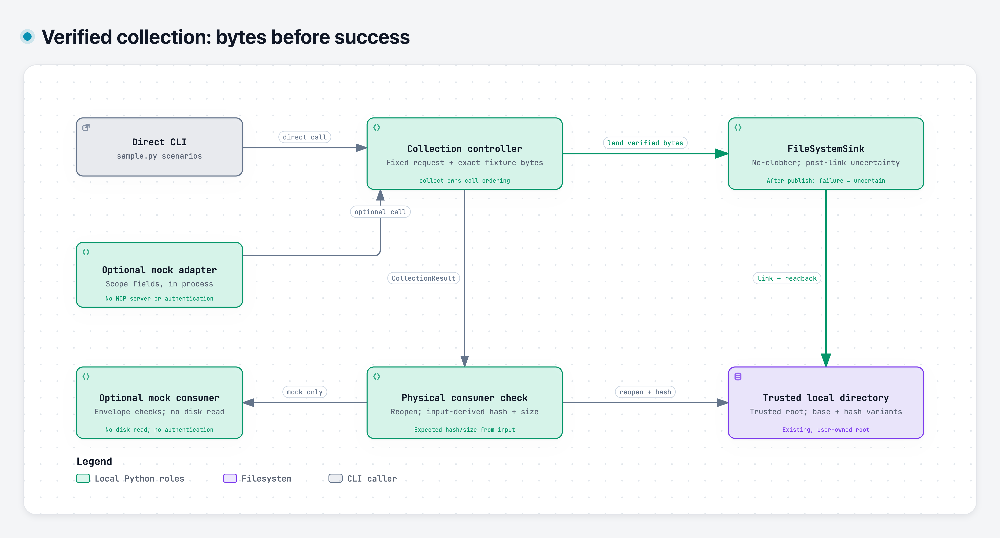

# Verified Artifact Collection

[Richard Wolff](https://github.com/wolffrichardj) · [Portfolio & case studies](https://richardwolff.me/) · [LinkedIn](https://www.linkedin.com/in/wolffrichardj)

[](https://github.com/wolffrichardj/verified-artifact-collection/actions/workflows/check.yml) · [Run the example](#run-the-example) · [Watch the walkthrough](#80-second-walkthrough) · [Scope & lineage](#scope-and-lineage)

**A completed tool call is not enough evidence that the right document was collected.** This small Python sample checks a fixed synthetic request, lands its bytes without overwriting existing content, and independently reopens the stored file before reporting success.

The concrete example is `statement-0001` for `demo_subject_01`, period `2026-01`. Collect version 1 twice, then version 2: the receipts report `created`, `duplicate`, then `variant`. A wrong subject refuses before landing; later byte tampering fails physical verification.

The engineering choice is to keep transport, content verification, storage and downstream verification separate. Existing different bytes are retained as a full-SHA-256 variant. If publication occurs but final readback or durability checks fail, the result is `landing_uncertain`, not success or an automatic retry.

This is an offline, source-derived sample with generated records. The MCP-shaped wrapper is an **in-process mock**, not a protocol server or authentication system. No accounts, credentials, provider data, model, dependency installation or background service are needed.

<a id="run-it"></a>

## Run the example

Python 3.11+ is the code target, on macOS/Linux filesystems supporting directory descriptors, no-follow/nonblocking opens, hard links and fsync. Unsupported primitives fail; there is no overwrite fallback. CI records the actual Python versions on standard Linux and macOS runners. No Windows support is claimed.

```sh
git clone https://github.com/wolffrichardj/verified-artifact-collection.git
cd verified-artifact-collection
python3 -B -m unittest discover -s . -p 'test_sample.py' -v
demo_root=$(mktemp -d)
python3 -B sample.py --root "$demo_root" --scenario happy
python3 -B sample.py --root "$demo_root" --scenario happy
python3 -B sample.py --root "$demo_root" --scenario revised
```

The original file remains unchanged; revised bytes receive a full-SHA-256 variant filename. Receipts contain relative filenames, hashes and sizes, not the document body.

These demonstrations intentionally exit **1**:

```sh
python3 -B sample.py --root "$demo_root" --scenario wrong-identity
python3 -B sample.py --root "$demo_root" --scenario tampered-source
```

Wrong identity refuses before landing. The tamper scenario collects and changes only its own generated artifact in a nested temporary directory. It reports `tamper_rejected` only after a hash mismatch and does not modify your existing demo artifacts. The two generated version artifacts remain in `$demo_root` for inspection; remove that directory yourself when finished.

<a id="80-second-walkthrough"></a>

## Watch the 80-second walkthrough

https://github.com/user-attachments/assets/b3ca3bdc-afdf-40e1-9eec-c17af56e9fb0

[**Watch or download the captioned walkthrough (MP4)**](docs/walkthrough/walkthrough.mp4)

Request-to-landing verification, no-overwrite variants and identity/tamper rejection.

[Transcript](docs/walkthrough/transcript.txt) · [Captions](docs/walkthrough/captions.srt) · [Reproduce the recorded behavior](docs/walkthrough/reproduce.sh) · [Context and source revision](docs/walkthrough/README.md)

This reviewed video presents genuine recorded output from synthetic fixtures, with neutral synthetic narration. It remains pinned to the earlier source revision recorded alongside the video; README changes do not update that historical recording.

<a id="ownership-boundaries"></a>

## Follow the code

[](docs/architecture/README.md)

The CLI and optional mock share the same collection core; success requires sink readback and separate physical verification. **Different bytes are retained; post-publication failures report `landing_uncertain`.**

[Architecture decisions and source map](docs/architecture/README.md) · [Download interactive HTML](docs/architecture/collection.html) · [Editable diagram source](docs/architecture/collection.architecture.json)

GitHub displays HTML source rather than running the viewer. Download the HTML file and open it locally; no server is needed.

| Entry point | Decision to inspect |
| --- | --- |
| [sample.py](sample.py): `collect`, frozen result types | Transport → verifier → sink ordering; reject incomplete readback evidence |
| [runtime.py](runtime.py): `SignatureVerifier` | Compare identity and exact generated bytes with the request; metadata attestation alone is insufficient |
| [runtime.py](runtime.py): `FileSystemSink` | Directory-relative operations, atomic no-clobber hard links, duplicate/variant reconciliation and final readback |
| [source_identity.py](source_identity.py): `SourceVerifier.verify` | Reopen physical bytes and check size and streaming SHA-256 against expected input values |
| [mock_mcp.py](mock_mcp.py): `accept_tool_payload` | Require outer invocation success plus complete positive domain, landing and serialized-result evidence |
| [test_sample.py](test_sample.py) | Positive and rejection cases, collisions, synchronized writer races, FIFO handling, fault injection and later tampering |

Nonblocking opens precede regular-file checks so a FIFO without a writer cannot hang the reader. Concurrent writers with identical bytes reconcile as duplicates. A losing writer with different bytes advances once to its full-hash variant; different content already occupying that name is an explicit error.

The tests include corrupted final readback, directory-fsync failure after publication and same-size later tampering. A socket/DNS/subprocess tripwire covers the mock end-to-end path; it is not a network sandbox. A post-publication failure preserves the candidate and reports uncertainty; it does not automatically delete the destination or retry. Downstream physical-verification failure separately refuses success.

## Try the mock tool boundary

```python
import tempfile
from mock_mcp import run, accept_tool_payload

with tempfile.TemporaryDirectory() as root:
    payload = run({
        "record_id": "statement-0001",
        "version": 1,
        "approval_name": "SIMULATED_APPROVAL",
        "approved_scope": {"record_id": "statement-0001", "version": 1},
    }, root=root)
    print(accept_tool_payload(payload))
```

The mock can return outer `ok: true` and `returncode: 0` while the inner domain result refuses. The consumer requires the complete positive result. These fields simulate an invocation; **no process was launched**. Approval and session fields are attestations supplied by trusted sample code, not authenticated principals. A forged, structurally valid receipt is not independently authenticated.

<a id="retained-behavior-and-new-fixes"></a>
<a id="limits"></a>

## Scope and lineage

The root must be an existing, trusted, user-owned directory; the walkthrough creates a fresh one. Sink paths are flat and generated. Hostile root-ancestor replacement and hostile concurrent mutation are outside scope. Hash agreement proves observed byte consistency, not provider authenticity, future integrity, remote retention or power-loss recovery. Injected transports, verifiers and sinks remain trusted collaborators.

The operational source separates workflow guidance, acquisition, MCP adaptation and downstream lakehouse/research responsibilities. This sample covers acquisition-to-consumer verification. It includes no live provider session, real provider registry, lakehouse transformation, research answers or personal workflow configuration. It does not establish MCP protocol compatibility, browser authentication, process isolation, live-provider reliability or autonomous agent correctness.

[PROVENANCE.md](PROVENANCE.md) distinguishes retained typed boundaries, ordering, variants and physical verification from new hardening. Exact request-to-fixture equality, directory-relative no-follow operations, no-clobber publication, final readback and bounded writer reconciliation are additions here, not guarantees attributed to every version of the original system. Two selected historical acquisition snapshots are retained; excluded private context remains private. New work is not backdated.

Richard Wolff's personal system supplied the selected source. Extraction, hardening and review used AI assistance; commit identity does not establish per-line human authorship. Tests and CI describe the tested revision and platform, not universal guarantees or business outcomes. This independent sample is [MIT licensed](LICENSE); original repositories retain their licenses and visibility.
