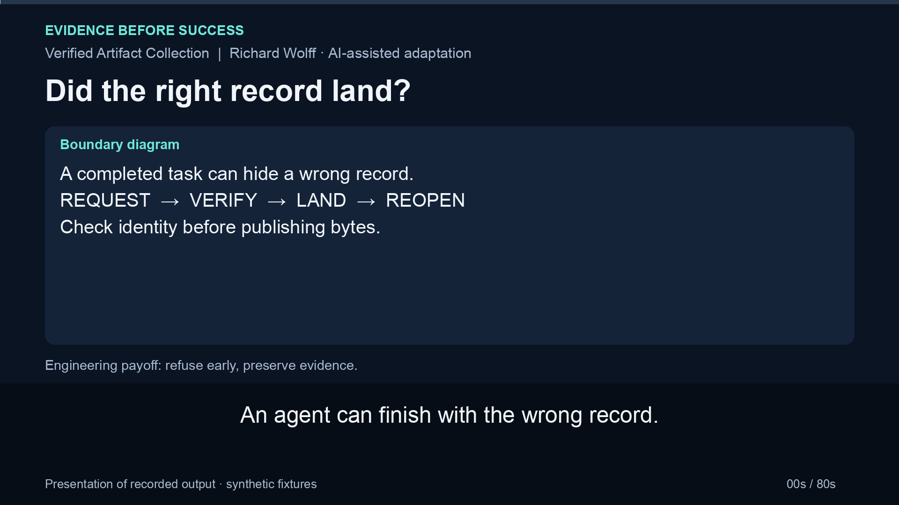
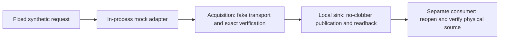

# Verified Artifact Collection

An agent completing a portal action does not prove that the right document arrived or that its bytes landed safely. This small offline sample makes those separate outcomes visible.

It adapts real collection and source-verification code into one generated-record walkthrough. Request-bound identity and bytes are checked before writing. Landing preserves different content as a hash-named variant, verifies final disk readback, and reports uncertainty after a publication failure. A separate read-only consumer detects later tampering.

No accounts, credentials, provider data, model, dependency installation or background service are needed. The MCP-shaped wrapper is an **in-process mock**, not a protocol server or authentication system.

## 80-second walkthrough

[**Watch or download the captioned walkthrough (MP4)**](docs/walkthrough/walkthrough.mp4)

[](docs/walkthrough/walkthrough.mp4)

Watch the request-to-landing verification, no-overwrite variants and identity/tamper rejection.

[Transcript](docs/walkthrough/transcript.txt) · [Captions](docs/walkthrough/captions.srt) · [Reproduce the recorded behavior](docs/walkthrough/reproduce.sh) · [Context and source revision](docs/walkthrough/README.md)

The video presents recorded output from synthetic fixtures, with neutral synthetic narration. Its pinned source revision is recorded alongside the video.

## Run it

Python 3.11+ is the code target, on macOS/Linux filesystems supporting the required directory descriptors, no-follow/nonblocking opens, hard links and fsync. Unsupported primitives fail; there is no overwrite fallback. CI records the actual Python versions on standard Linux and macOS runners. No Windows support is claimed.

```sh
git clone https://github.com/wolffrichardj/verified-artifact-collection.git
cd verified-artifact-collection
python3 -B -m unittest discover -s . -p 'test_sample.py' -v
demo_root=$(mktemp -d)
python3 -B sample.py --root "$demo_root" --scenario happy
python3 -B sample.py --root "$demo_root" --scenario happy
python3 -B sample.py --root "$demo_root" --scenario revised
```

The three JSON receipts report `created`, `duplicate`, then `variant`. The original file remains unchanged; the revised bytes receive a full-SHA-256 variant filename. Receipts contain relative filenames, hashes and sizes, not the document body.

These demonstrations intentionally exit **1**:

```sh
python3 -B sample.py --root "$demo_root" --scenario wrong-identity
python3 -B sample.py --root "$demo_root" --scenario tampered-source
```

Wrong identity refuses before landing. The tamper demonstration collects and changes only its own generated artifact in a nested temporary directory, then reports `tamper_rejected` only after a hash mismatch. It does not modify your existing demo artifacts. The two generated artifacts remain in `$demo_root` for inspection; remove that directory yourself when finished.

## Ownership boundaries



| File | Responsibility |
| --- | --- |
| [sample.py](sample.py) | Typed collection sequence, one generated fixture, safe CLI walkthrough |
| [runtime.py](runtime.py) | Request/content equality and filesystem landing |
| [source_identity.py](source_identity.py) | Read-only path, size and streaming physical SHA-256 verification |
| [mock_mcp.py](mock_mcp.py) | Scope validation and separate outer-invocation/inner-domain results |
| [test_sample.py](test_sample.py) | Positive, rejection, collision, concurrent-writer, FIFO, fault and tamper cases |

The operational source system keeps workflow guidance, acquisition, MCP adaptation and downstream lakehouse/research responsibilities separate. This sample demonstrates the acquisition-to-consumer boundary. It contains no lakehouse transformation, research answers, real provider registry or personal workflow configuration.

## Try the mock tool boundary

```python
import tempfile
from mock_mcp import run, accept_tool_payload

with tempfile.TemporaryDirectory() as root:
    payload = run({
        "record_id": "statement-0001",
        "version": 1,
        "approval_name": "SIMULATED_APPROVAL",
        "approved_scope": {"record_id": "statement-0001", "version": 1},
    }, root=root)
    print(accept_tool_payload(payload))
```

The mock can return outer `ok: true` and `returncode: 0` while the inner domain result refuses. The consumer requires the complete positive domain and landing evidence. These invocation fields simulate an interface; **no process was launched**. Approval and session fields are attestations supplied by trusted sample code, not authenticated principals. A forged, structurally valid receipt is not independently authenticated.

## Retained behavior and new fixes

Retained source ideas include frozen transport/artifact/result types, transport → verifier → sink ordering, injected collaborators, identical-byte reuse, deterministic content variants, and downstream physical hashing. See [provenance](PROVENANCE.md) for what history was retained.

The adaptation adds exact request-to-fixture equality, flat sink basenames, directory-relative no-follow operations, atomic hard-link publication instead of replacement, final length/hash readback, and bounded concurrent-writer reconciliation. If another writer wins with the same bytes, the loser reports duplicate. If it wins with different bytes, the loser advances once to its full-hash variant. Different content already occupying that variant is an explicit error.

Nonblocking opens precede regular-file checks so a FIFO without a writer cannot hang the reader. A sink failure after publication preserves the candidate and reports `landing_uncertain`; it does not automatically retry or delete the destination. A later consumer-verification failure separately refuses success. These fixes are new here, not claims about every behavior of the original system.

The tests include an actual corrupted final readback, a directory-fsync failure after publication, synchronized writer races and same-size later tampering. One regression test denies socket/DNS/subprocess entry points during the mock end-to-end path. That tripwire is not a network sandbox.

## Limits

The root must be an existing, trusted, user-owned directory; the walkthrough creates a fresh one. Sink paths are flat and generated. Hostile root-ancestor replacement and hostile concurrent mutation are outside scope. Hash agreement proves observed byte consistency, not provider authenticity, future integrity, remote retention or power-loss recovery.

Injected transports, verifiers and sinks remain trusted collaborators. The mock does not establish actual MCP compatibility, browser authentication, process isolation, live-provider reliability or autonomous agent correctness. Tests and CI report behavior for the tested revision and platform, not universal guarantees or business outcomes.

Richard Wolff's personal system supplied the selected source. The extraction, hardening and review used AI assistance. Commit identity does not establish per-line human authorship. This independent selected sample is [MIT licensed](LICENSE); it does not change the licenses or visibility of any original repository.
