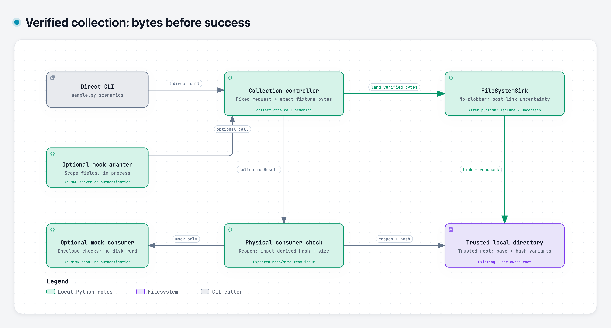

# Verified artifact collection: what counts as collected?

A successful invocation is only one signal. This offline sample ties a fixed synthetic request to exact fixture bytes, publishes without replacing existing content, checks the sink's readback evidence, then independently reopens the physical file before emitting a positive receipt.

The key decision is to retain different bytes and expose uncertainty. Collect version 1 twice, then version 2: `created`, `duplicate`, `variant`. If this attempt publishes but directory sync or final readback fails, `landing_uncertain` preserves the destination and refuses success. The code does not automatically delete or retry it.

[](collection.svg)

[Download interactive HTML](collection.html) · [Editable candidate](collection.architecture.json) · [Portable byte manifest](manifest.json)

## Read the diagram

The overview shows roles in one Python process, not deployed services. The CLI calls the acquisition helper directly. The optional MCP-shaped mock validates its supplied scope fields, calls the same helper, runs physical verification, and creates an envelope. No actual MCP server, subprocess, live provider, authenticated principal or model participates.

`collect` owns the ordering: validate the request and simulated session, call the transport, call the verifier, then call the sink. The normal helper injects `FakeTransport`, `SignatureVerifier` and `FileSystemSink`. The transport returns generated bytes in memory. `SignatureVerifier` checks media type, magic, metadata identity and exact equality to `fixture_bytes(request)` within 64 KiB. This is fixture verification; the class name does not establish a cryptographic signature or provider authenticity.

`FileSystemSink` owns filesystem reads/writes, directory-relative operations, exclusive temporary-file creation, file fsync, no-clobber hard-link publication, directory fsync and final readback. Its result must contain matching SHA-256, size and positive readback evidence before `collect` returns a `CollectionResult`.

`receipt` separately derives expected SHA-256 and size from the verified input artifact, then calls `SourceVerifier.verify` to reopen the stored path and stream its physical bytes. A missing file, changed size or same-size byte tamper refuses success. This separate consumer check is not a separate process or security boundary. `accept_tool_payload` checks outer invocation success, complete positive inner evidence and JSON consistency; it does not reopen the file or authenticate a forged receipt.

## No-clobber decisions

| Observed condition | Decision |
| --- | --- |
| Base path absent; hard link succeeds | Publish at base name: `created` |
| Selected base or variant already has identical bytes | Reuse after final readback: `duplicate` |
| Base contains different bytes | Select `__variant-<full SHA-256>` name, preserving base |
| Race loser sees identical winning bytes | Reconcile as `duplicate` |
| Race loser sees different base bytes | Advance once to the full-hash variant |
| Variant name contains different bytes | Refuse with `variant_collision` |
| This attempt published, then sync/readback failed | Preserve destination and raise `landing_uncertain` |

Failures before this attempt publishes do not imply that it created a destination. A physical-verification failure after collection is a separate rejection. No general rollback, hostile concurrent-mutation defense or power-loss recovery guarantee is claimed.

## Trust and scope

The root must already exist, be trusted and owned by the current user. The sample uses flat generated sink names, directory descriptors, no-follow/nonblocking opens and bounded regular-file reads. It targets macOS/Linux filesystems with the required POSIX primitives; unsupported operations fail, with no overwrite fallback. Root-ancestor replacement and hostile concurrent mutation remain outside scope. Injected transports, verifiers and sinks are trusted collaborators.

The simulated approval/session fields are code-supplied attestations. Hash agreement proves observed byte consistency, not provider authenticity, future integrity or remote retention. A structurally valid forged receipt is not independently authenticated. This selected source adaptation and hardening used AI assistance; [PROVENANCE.md](../../PROVENANCE.md) explains lineage and additions. No operational account, record corpus or private harness is bundled.

## Open or regenerate

GitHub displays the static image and Markdown; it does **not execute checked-in HTML**. Download [collection.html](collection.html) with GitHub's Raw/Download control, save it as an HTML file, then open the saved file in a browser. Or clone the repository and open `docs/architecture/collection.html`. Viewing needs no server or installation. The viewer includes light/dark themes, clickable source ranges and full-diagram exports.

The candidate's source identity is pinned to public commit [`7a59f67c2f4153adb6e2d52d182b0289e555ac0d`](https://github.com/wolffrichardj/verified-artifact-collection/tree/7a59f67c2f4153adb6e2d52d182b0289e555ac0d). Documentation may have a newer commit. Source links describe that baseline, not uncommitted or private code.

| Responsibility | Pinned evidence |
| --- | --- |
| Request, controller ordering, helper injection | [sample.py:83–155](https://github.com/wolffrichardj/verified-artifact-collection/blob/7a59f67c2f4153adb6e2d52d182b0289e555ac0d/sample.py#L83-L155) |
| Exact fixture verification | [runtime.py:23–44](https://github.com/wolffrichardj/verified-artifact-collection/blob/7a59f67c2f4153adb6e2d52d182b0289e555ac0d/runtime.py#L23-L44) |
| Publication and uncertainty | [runtime.py:104–177](https://github.com/wolffrichardj/verified-artifact-collection/blob/7a59f67c2f4153adb6e2d52d182b0289e555ac0d/runtime.py#L104-L177) |
| Input-derived expectation and separate physical read | [sample.py:158–169](https://github.com/wolffrichardj/verified-artifact-collection/blob/7a59f67c2f4153adb6e2d52d182b0289e555ac0d/sample.py#L158-L169), [source_identity.py:31–52](https://github.com/wolffrichardj/verified-artifact-collection/blob/7a59f67c2f4153adb6e2d52d182b0289e555ac0d/source_identity.py#L31-L52) |
| Optional mock and payload consumer | [mock_mcp.py:30–83](https://github.com/wolffrichardj/verified-artifact-collection/blob/7a59f67c2f4153adb6e2d52d182b0289e555ac0d/mock_mcp.py#L30-L83) |

Arrows identify calls, returned values or physical I/O by their text. The collection node groups its in-memory transport/verifier collaborators; the consumer node groups `receipt` and `SourceVerifier`. The CLI/mock callers pass the returned result to `receipt`; the `CollectionResult` arrow describes that data handoff, not a direct call from `collect` to `SourceVerifier`. An architecture view keeps storage ownership visible; a sequence view would emphasize one invocation and a lifecycle view only the landing outcomes.

Authored/rendered with [Archify](https://github.com/tt-a1i/archify) 3.2.0 by tt-a1i, MIT, with embedded JetBrains Mono under SIL OFL 1.1. See [renderer license](licenses/Archify-MIT.txt) and [font license](licenses/JetBrainsMono-OFL.txt). Archify is an authoring tool, not a sample runtime dependency. This documentation also used AI assistance.

To regenerate with a separately obtained Archify 3.2.0 package and Node.js 18+, set `ARCHIFY_CLI` to its `bin/archify.mjs` and `ARCHIFY_EVIDENCE` to an existing private directory outside this checkout. From the repository root:

```sh
node "$ARCHIFY_CLI" finalize architecture docs/architecture/collection.architecture.json docs/architecture/collection.html --repo-root . --quality showcase --out-dir "$ARCHIFY_EVIDENCE/review-1" --json
node "$ARCHIFY_CLI" visual-check docs/architecture/collection.html --out-dir "$ARCHIFY_EVIDENCE/visual-1" --summary --require-provenance
```

Require every finalize gate to pass and inspect the actual captures. After edits use a fresh evidence directory. Use the viewer's canonical Export menu for PNG and dual-theme SVG; inspect the static image at README width. Keep host-specific delivery/browser receipts private. [manifest.json](manifest.json) binds public candidate, HTML and exports by SHA-256 and size; it is **not** an exact strict-provenance receipt or a claim of future integrity. Regeneration creates a new local provenance pair; renderer/environment changes may change output bytes.
